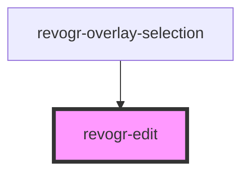

<!-- Auto Generated Below -->

## Overview

Represents a cell editor in a grid.
It manages the editing of cells by handling events, saving data, rendering the editor UI,
and managing the lifecycle of the editor instance.

## Properties

| Property         | Attribute         | Description                                                            | Type                                                                                                                                            | Default     |
| ---------------- | ----------------- | ---------------------------------------------------------------------- | ----------------------------------------------------------------------------------------------------------------------------------------------- | ----------- |
| `additionalData` | `additional-data` | Additional data to pass to renderer                                    | `any`                                                                                                                                           | `undefined` |
| `column`         | --                | Column data for editor.                                                | `ColumnDataSchemaModel<DataType<any, ColumnProp>, ColumnRegular<ColumnProp, DataType<any, ColumnProp>>, ColumnProp> \| null`                    | `undefined` |
| `editCell`       | --                | Cell to edit data.                                                     | `EditCellStore & BeforeSaveDataDetails<DataType, ColumnRegular<ColumnProp, DataType<any, ColumnProp>>>`                                         | `undefined` |
| `editor`         | --                | Custom editors register                                                | `EditorCtrCallable & { prepareOnFocus?: boolean \| undefined; } \| EditorCtrConstructible & { prepareOnFocus?: boolean \| undefined; } \| null` | `undefined` |
| `requestEdit`    | --                | Prepare the editor to start editing through the selection owner.       | `(() => boolean) \| undefined`                                                                                                                  | `undefined` |
| `saveOnClose`    | `save-on-close`   | Save on editor close. Defines if data should be saved on editor close. | `boolean`                                                                                                                                       | `false`     |

## Events

| Event          | Description                                                  | Type                                                                                                                                   |
| -------------- | ------------------------------------------------------------ | -------------------------------------------------------------------------------------------------------------------------------------- |
| `celleditinit` | Cell edit event initiator, first in the cellEdit event chain | `CustomEvent<{ rgRow: number; rgCol: number; type: DimensionRows; prop: ColumnProp; val: any; preventFocus?: boolean \| undefined; }>` |
| `closeedit`    | Close editor event pass true if requires focus next          | `CustomEvent<boolean \| undefined>`                                                                                                    |

## Methods

### `beforeDisconnect() => Promise<void>`

Before editor got disconnected.
Can be triggered multiple times before actual disconnect.

#### Returns

Type: `Promise<void>`

### `cancelChanges() => Promise<void>`

Cancel pending changes flag. Editor will be closed without autosave.

#### Returns

Type: `Promise<void>`

## Dependencies

### Used by

 - [revogr-overlay-selection](../overlay)

### Graph

----------------------------------------------

*Built with ❤️ by Revolist OU*
