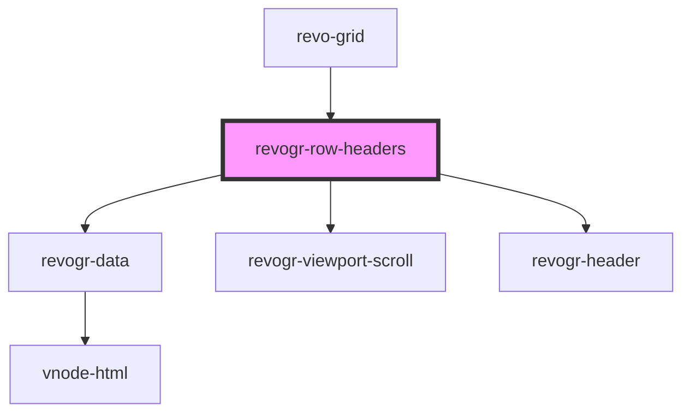

<!-- Auto Generated Below -->

## Overview

Row headers component
Visible on the left side of the table

## Properties

| Property            | Attribute         | Description                                                                                                                                                                                | Type                             | Default     |
| ------------------- | ----------------- | ------------------------------------------------------------------------------------------------------------------------------------------------------------------------------------------ | -------------------------------- | ----------- |
| `accessible`        | `accessible`      | Enable accessible row header semantics.                                                                                                                                                    | `boolean`                        | `false`     |
| `additionalData`    | `additional-data` | Additional data to pass to renderer                                                                                                                                                        | `any`                            | `undefined` |
| `dataPorts`         | --                | Viewport data                                                                                                                                                                              | `ViewportData[]`                 | `undefined` |
| `headerProp`        | --                | Header props                                                                                                                                                                               | `any \| string`                  | `undefined` |
| `height`            | `height`          | Header height to setup row headers                                                                                                                                                         | `number`                         | `undefined` |
| `jobsBeforeRender`  | --                | Prevent rendering until job is done. Can be used for initial rendering performance improvement. When several plugins require initial rendering this will prevent double initial rendering. | `Promise<any>[]`                 | `[]`        |
| `resize`            | `resize`          | Enable resize                                                                                                                                                                              | `boolean`                        | `undefined` |
| `rowClass`          | `row-class`       | Row class                                                                                                                                                                                  | `string`                         | `undefined` |
| `rowHeaderColumn`   | --                | Row header column                                                                                                                                                                          | `RowHeaders`                     | `undefined` |
| `treegridOwnership` | --                | Accessibility ownership of the row-header data panes.                                                                                                                                      | `TreegridOwnership \| undefined` | `undefined` |

## Events

| Event        | Description                | Type                         |
| ------------ | -------------------------- | ---------------------------- |
| `ref`        | Register element to scroll | `CustomEvent<ElementScroll>` |
| `scrollview` | Scroll viewport            | `CustomEvent<D>`             |

## Dependencies

### Used by

 - [revo-grid](../revoGrid)

### Depends on

- [revogr-data](../data)
- [revogr-viewport-scroll](../scroll)
- [revogr-header](../header)

### Graph

----------------------------------------------

*Built with ❤️ by Revolist OU*
