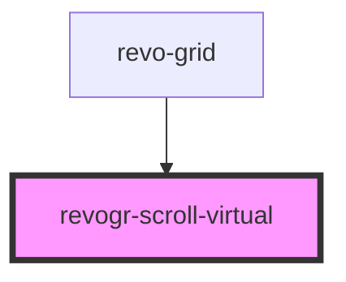

<!-- Auto Generated Below -->

## Overview

Virtual scroll component

## Properties

| Property                   | Attribute      | Description                                                 | Type                                  | Default     |
| -------------------------- | -------------- | ----------------------------------------------------------- | ------------------------------------- | ----------- |
| `clientSize` _(required)_  | `client-size`  | Client size                                                 | `number`                              | `undefined` |
| `dimension`                | `dimension`    | Scroll dimension (`X` - `rgCol` or `Y` - `rgRow`)           | `"rgCol" \| "rgRow"`                  | `'rgRow'`   |
| `dimensionStore`           | --             | Grid-owned size source, updated before component rendering. | `DimensionSettingsState \| undefined` | `undefined` |
| `realSize`                 | `real-size`    | Content size for scrollbars without a dimension store.      | `number`                              | `0`         |
| `virtualSize` _(required)_ | `virtual-size` | Virtual size                                                | `number`                              | `undefined` |

## Events

| Event           | Description  | Type             |
| --------------- | ------------ | ---------------- |
| `scrollvirtual` | Scroll event | `CustomEvent<D>` |

## Methods

### `changeScroll(e: ViewPortScrollEvent) => Promise<ViewPortScrollEvent>`

Update if `delta` exists in case we don't know current position or if it's external change

#### Parameters

| Name | Type                                                                                                             | Description |
| ---- | ---------------------------------------------------------------------------------------------------------------- | ----------- |
| `e`  | `{ dimension: DimensionType; coordinate: number; delta?: number \| undefined; outside?: boolean \| undefined; }` |             |

#### Returns

Type: `Promise<ViewPortScrollEvent>`

### `setScroll(e: ViewPortScrollEvent) => Promise<void>`

#### Parameters

| Name | Type                                                                                                             | Description |
| ---- | ---------------------------------------------------------------------------------------------------------------- | ----------- |
| `e`  | `{ dimension: DimensionType; coordinate: number; delta?: number \| undefined; outside?: boolean \| undefined; }` |             |

#### Returns

Type: `Promise<void>`

## Dependencies

### Used by

 - [revo-grid](../revoGrid)

### Graph

----------------------------------------------

*Built with ❤️ by Revolist OU*
